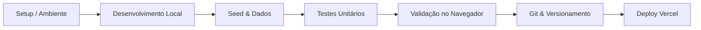

# Workflow Principal: Lumina (The Living Canvas)

Este documento define o workflow oficial de desenvolvimento, manutenção e ciclo de vida da plataforma **Lumina Canvas**, desenvolvida em **Django 5.2**, **Vanilla CSS (Neo-Glassmorphism)** e **JavaScript Vanilla**.

---

## 1. Visão Geral do Ciclo de Desenvolvimento

O fluxo de trabalho do projeto Lumina é estruturado em etapas sequenciais padronizadas:



---

## 2. Etapas Operacionais

### Etapa 1: Inicialização do Ambiente
1. Ative o ambiente virtual e instale as dependências:
   ```powershell
   .\manage.ps1 setup
   ```
2. Verifique o arquivo de variáveis de ambiente:
   - Certifique-se de que o `.env` está presente na raiz com `SECRET_KEY` e `DEBUG=True`.

### Etapa 2: Execução do Servidor Local
1. Inicie o servidor de desenvolvimento na porta padrão:
   ```powershell
   .\manage.ps1 runserver
   ```
2. Acesse a aplicação no navegador em: `http://127.0.0.1:8000/`

### Etapa 3: Carga de Dados e Demonstração
1. Para popular o banco com usuários fotógrafos, posts visuais e tags neon:
   ```powershell
   .\manage.ps1 seed
   ```
2. **Credenciais padrão de teste**:
   - Usuário: `lumina_demo`
   - Senha: `lumina123456`

### Etapa 4: Execução da Suíte de Testes
1. Execute a verificação automatizada de models, views e fluxos de autenticação:
   ```powershell
   .\manage.ps1 test
   ```
2. Todos os 8 testes devem retornar `OK` sem regressões.

### Etapa 5: Validação de Interface (E2E)
Consulte o guia dedicado [workflow_validacao.md](file:///c:/Users/Vitor/OneDrive/Desktop/Arquivos/VS+AntiGravity/Projeto07/.agents/workflows/workflow_validacao.md) para o checklist de aceitação no navegador das rotas:
- `/` (Feed com stories e telemetria EXIF)
- `/explore/` (Mural dinâmico com filtros de tags neon)
- `/create/` (Upload com live preview e metadados)
- `/profile/<user>/` (Portfólio do artista)

### Etapa 6: Controle de Versão e Commits
Consulte o guia [workflow_git.md](file:///c:/Users/Vitor/OneDrive/Desktop/Arquivos/VS+AntiGravity/Projeto07/.agents/workflows/workflow_git.md) para:
- Convenção de commits (`feat`, `fix`, `docs`, `style`, `test`, `chore`).
- Proteção de histórico e staging consciente.

### Etapa 7: Rastreamento de Falhas e Depuração
Consulte o guia [workflow_debug.md](file:///c:/Users/Vitor/OneDrive/Desktop/Arquivos/VS+AntiGravity/Projeto07/.agents/workflows/workflow_debug.md) para:
- Protocolo de 4 passos de diagnóstico.
- Verificação de CSRF, formulários multipart e consultas ORM.

### Etapa 8: Deploy em Nuvem
Consulte o guia [workflow_deploy.md](file:///c:/Users/Vitor/OneDrive/Desktop/Arquivos/VS+AntiGravity/Projeto07/.agents/workflows/workflow_deploy.md) para:
- Preparação de build serverless no Vercel.
- Gestão de arquivos estáticos via WhiteNoise.
