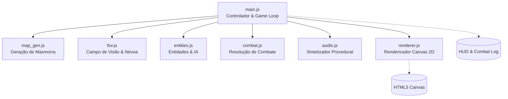
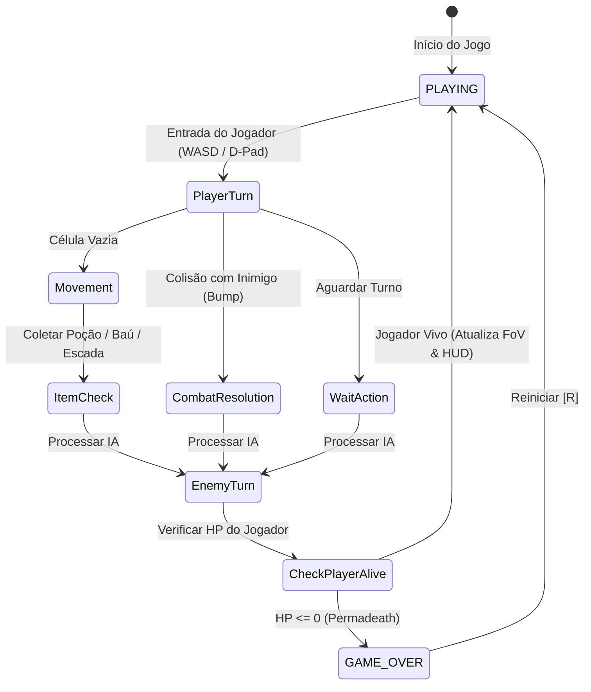

# Arquitetura do Sistema - Roguelike Masmorra

Este documento descreve a arquitetura de software, padrão de projeto, ciclo de vida de execução e fluxo de dados do **Dungeon Roguelike**.

---

## 1. Visão Geral Arquitetural

O projeto adota uma arquitetura em **módulos desacoplados ES6 puros (Vanilla)**, sem frameworks ou bundlers, permitindo execução direta e imediata pelo navegador através de carregamento nativo (`<script type="module">`).

---

## 2. Padrão de Ciclo de Turnos (Turn-Based State Machine)

O jogo opera segundo uma máquina de estados estrita baseada em ações do jogador:

### Regra de Ouro dos Turnos
- O mundo permanece estático até que o jogador execute uma ação válida (movimento, ataque voluntário ou passe de turno).
- Cada ação do jogador incrementa o contador de turnos (`player.turns++`) e aciona sequencialmente a rodada de decisões de todos os monstros ativos no mapa.

---

## 3. Estrutura Modular dos Componentes

| Módulo | Padrão Utilizado | Responsabilidade Principal |
|---|---|---|
| [`src/main.js`](../src/main.js) | Controller / Orchestrator | Gerencia o estado global, inputs do usuário, inicialização de andares e comunicação com o DOM. |
| [`src/map_gen.js`](../src/map_gen.js) | Procedural Generator | Gera salas retangulares não sobrepostas e escava corredores ortogonais em L com conectividade 100% garantida. |
| [`src/fov.js`](../src/fov.js) | Spatial Raycaster | Projeta raios angulares a partir do jogador, identifica oclusões causadas por paredes e atualiza a matriz de exploração. |
| [`src/entities.js`](../src/entities.js) | Entity Hierarchy / AI | Modela o Jogador, tipos de Inimigos (Goblin, Esqueleto, Ogro) e Itens coletáveis, incluindo heurística de perseguição direta. |
| [`src/combat.js`](../src/combat.js) | Combat Domain Service | Calcula a fórmula de dano mitigado por defesa, variação aleatória de impacto, acertos críticos e formatação de logs. |
| [`src/renderer.js`](../src/renderer.js) | 2D Canvas Engine | Desenha os tiles com iluminação tocha dinâmica, gerencia câmera virtual que segue o jogador, renderiza sprites e textos flutuantes. |
| [`src/audio.js`](../src/audio.js) | Audio Synthesizer (Singleton) | Sintetiza frequências sonoras proceduralmente sem arquivos de mídia usando `AudioContext`, `OscillatorNode` e `GainNode`. |

---

## 4. Gerenciamento de Memória e Performance

- **Canvas Buffering**: Renderização direta com cálculo de *viewport culling*, desenhando apenas as células da grade que intersectam a câmera visível atual (`startCol` a `endCol`, `startRow` a `endRow`).
- **Arrays Tipados**: Uso de `Uint8Array` para mapas e matrizes de visão (`visible` e `explored`), reduzindo a sobrecarga do coletor de lixo (GC) e garantindo acesso de alta velocidade.
- **Áudio Desacoplado**: Conexões de nós de áudio são criadas sob demanda e liberadas assim que o som encerra (`osc.stop(now + duration)`).
