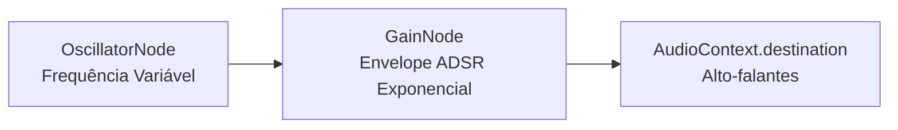

# Síntese Sonora Procedural com Web Audio API

Este documento técnico explica a arquitetura e parametrização dos efeitos sonoros sintetizados proceduralmente no módulo [`src/audio.js`](../src/audio.js).

---

## 1. Princípios de Projeto de Áudio

1. **Zero Assets Externos**: Sem arquivos `.mp3`, `.wav` ou `.ogg` hospedados localmente ou remotamente.
2. **Latência Zero**: Como os sons são sintetizados diretamente pelo hardware do navegador através da Web Audio API, não existe tempo de carregamento ou buffering de rede.
3. **Compatibilidade com Política de Autoplay**: O `AudioContext` só é instanciado e ativado após o primeiro gesto de interação do usuário (clique ou pressão de tecla).

---

## 2. Mapa de Efeitos Sonoros

| Efeito | Método | Tipo de Onda | Envelope & Frequência | Duração | Descrição Timbrica |
|---|---|---|---|---|---|
| **Passo** | `playStep()` | `triangle` | $140\text{ Hz} \to 40\text{ Hz}$ (queda exponencial) | 0.04s | Som abafado e curto de bota sobre laje de pedra. |
| **Golpe de Espada** | `playSword()` | `sawtooth` | $420\text{ Hz} \to 160\text{ Hz}$ (rampa exponencial) | 0.12s | Silvo agudo de lâmina cortando o ar com harmônicos. |
| **Impacto de Ataque** | `playHit()` | `square` | $220\text{ Hz} \to 55\text{ Hz}$ (rampa exponencial) | 0.10s | Pancada seca com textura áspera e percussiva. |
| **Dano no Jogador** | `playPlayerDamage()` | `sawtooth` | $180\text{ Hz} \to 70\text{ Hz}$ (rampa linear) | 0.22s | Zumbido grave de impacto doloroso e alarme. |
| **Poção de Cura** | `playPotion()` | `sine` | Arpejo: C5 (523Hz), E5 (659Hz), G5 (784Hz), C6 (1046Hz) | 0.30s | Quatro notas ascendentes cristalinas e mágicas. |
| **Baú de Tesouro** | `playChest()` | `triangle` | Acorde maior com brilho: A4 (440Hz), C#5 (554Hz), E5 (659Hz), A5 (880Hz) | 0.35s | Clarim heróico de conquista de item valioso. |
| **Escadaria** | `playStairs()` | `sine` | Passagem descendente: 600Hz, 480Hz, 360Hz, 240Hz | 0.40s | Transição misteriosa para as profundezas da masmorra. |
| **Morte / Fim** | `playDeath()` | `sawtooth` | Queda dissonante: 330Hz, 311Hz, 293Hz, 220Hz, 110Hz | 0.80s | Acorde menor decadente simbolizando a derrota definitiva. |

---

## 3. Diagrama de Conexão de Nós

Cada chamada cria os nós de oscilação e ganho dedicados, agenda o envelope preciso em `currentTime` e descarta os objetos ao término (`osc.stop()`), prevenindo vazamento de memória.
